# LendSwift — multi-step loan application

An eight-step digital loan application for **Personal, Home and Business loans**, built for
LendSwift, a fictional NBFC serving tier-2 and tier-3 India on patchy mobile networks. It
replaces a single-page form that lost 45% of applicants with a guided flow that validates
gently, saves as you go and works from 320 px phones up.

> **Live demo:** not deployed; run it locally with the [Quick start](#quick-start) below.
> LendSwift is fictional. Nothing you enter leaves your browser; verification is simulated
> and no credit decision is made.

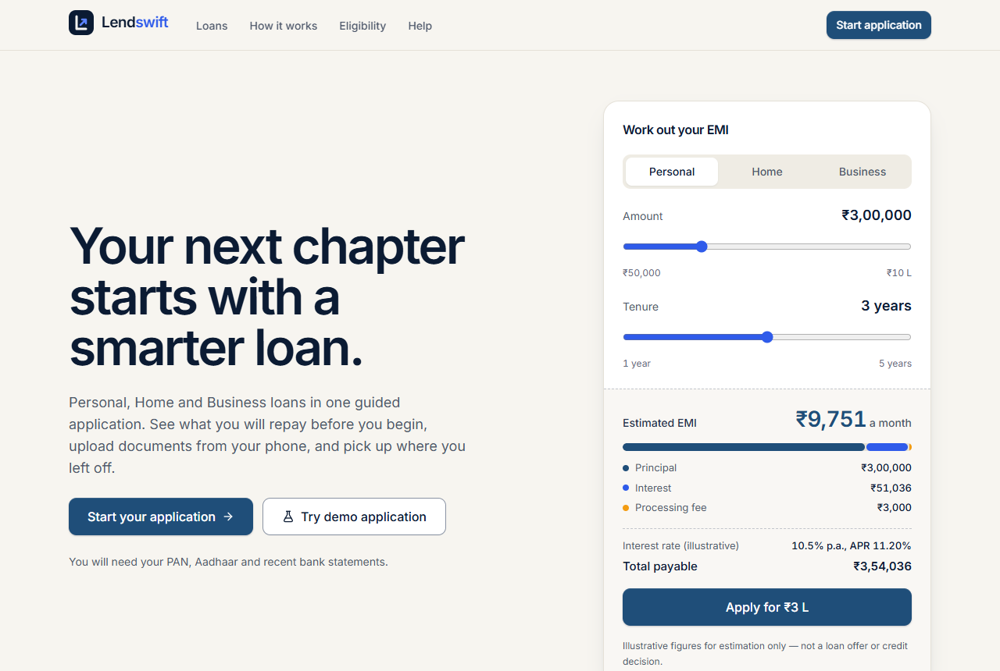

## Contents

- [What it does](#what-it-does)
- [Quick start](#quick-start)
- [A five-minute tour for reviewers](#a-five-minute-tour-for-reviewers)
- [Architecture decisions](#architecture-decisions)
- [Testing](#testing)
- [Performance and accessibility](#performance-and-accessibility)
- [Screenshots](#screenshots)
- [Assumptions and known limitations](#assumptions-and-known-limitations)
- [Deploy](#deploy)

## What it does

| Step | Highlights |
| --- | --- |
| 1 · Loan | Product cards, Indian-formatted amount with slider, tenure trimmed by age (must end by 65), purpose per product, live EMI ledger |
| 2 · About you | Name as on PAN, age 21–65 with exact-birthday handling, simulated mobile OTP (code shown on screen), optional email OTP |
| 3 · Identity | PAN format + 4th-character entity check, Aadhaar Verhoeff checksum, 1.5 s simulated verification, explicit Aadhaar consent, passport field for Home Loans above ₹50 lakh |
| 4 · Address | PIN-code lookup (100+ PINs, all 28 states and 8 UTs) fills city and state, rent for tenants, previous address under one year, permanent address, optional proof of address |
| 5 · Income | Salaried / self-employed / business owner sub-forms (discriminated union), GSTIN checksum, switching asks before clearing the other branch, Business Loans refuse salaried, salaried applicants can add up to three previous employers |
| 6 · Co-applicant | Appears only when needed (Personal > ₹5 lakh, all Home, Business > ₹20 lakh), Spouse default when married, PAN verification, consent and signature |
| 7 · Documents | Requirements change with loan, employment and PAN status; drag-and-drop; type, content, size and count checks; photos compressed on the device; progress and retry; encrypted IndexedDB vault for crash recovery; e-signature (draw with `react-signature-canvas`, or type) |
| 8 · Review | Key Fact Statement with APR, editable section summaries with masked PAN/Aadhaar/income, four separate unticked consents, extra acknowledgement when EMI > 50% of income, cooling-off, grievance officer and RBI Ombudsman path, gated submit, UUID reference, PDF summary |

Across the flow: encrypted auto-save (AES-256-GCM, 72-hour expiry, tamper detection),
resume-or-start-fresh prompt, multi-tab warning, offline banner, 15-minute idle timeout,
browser Back support, and a **demo mode** with four synthetic scenarios that never skips a
check. Motion stays restrained: buttons give slightly when pressed, the calculator's loan-type
switch slides, FAQ answers and the phone step list settle in. Hover effects only apply on
devices that can hover, and a reduced-motion setting turns the movement off.

## Quick start

Requires Node.js 20.19 or newer.

```bash
npm install
npm run dev          # http://localhost:5173
npm test             # unit and integration tests (Vitest)
npm run test:e2e     # builds, serves on :4173 and runs every Cypress journey
```

| Script | What it does |
| --- | --- |
| `npm run dev` | Development server with hot reload |
| `npm run build` / `npm run preview` | Type-check and production build / serve the build |
| `npm test` · `npm run test:coverage` | Vitest once · with a coverage report in `coverage/` |
| `npm run test:e2e` | Build, start `vite preview` and run Cypress headlessly |
| `npm run cypress:open` | Cypress interactive runner (start `npm run preview:e2e` first) |
| `npm run lint` · `npm run typecheck` | ESLint (Airbnb rules) · `tsc -b` |

**Note for VS Code terminals on Windows:** if Cypress fails with `bad option: --smoke-test`,
the editor has set `ELECTRON_RUN_AS_NODE`. Run `env -u ELECTRON_RUN_AS_NODE npm run test:e2e`
(Git Bash) or clear the variable first.

## A five-minute tour for reviewers

1. On the landing page, drag the **EMI calculator**, then choose **Try demo application** and
   pick **Home Loan with a spouse**.
2. In each step press **Fill this step**, then **Continue**. Verify the mobile number with the
   code shown on screen, and press **Verify** on PAN and Aadhaar — the demo leaves every check
   to you.
3. Watch the conditional rules: the passport field (Home > ₹50 lakh), Step 6 with Spouse
   pre-selected, rent counted in the ledger, property documents in the checklist.
4. On Step 7, **Fill this step** sends generated sample files through the real uploader
   (checks, compression, progress, simulated verification).
5. On the review page, use **Edit** on any section, read the Key Fact Statement, tick the four
   consents and submit. Download the PDF summary.
6. Try the edge cases: reload mid-way and resume; change the loan amount to ₹5,00,000 and
   ₹5,00,001 on a Personal Loan; switch employment type after filling it; open the app in a
   second tab.

## Architecture decisions

A full walkthrough is in **[ARCHITECTURE.md](ARCHITECTURE.md)**. In short:

- **Wizard with a step registry.** Steps are declared once (`constants/steps.ts`) and the
  Wizard handles order, gating, history and focus without knowing any fields. Step 6 is
  inserted or removed by deriving the active steps from the data on every render, so it can
  never get out of sync.
- **React Hook Form over Formik.** Uncontrolled inputs mean typing re-renders only the field,
  not the step — noticeable on low-end phones. Its resolver API plugs straight into Zod, and
  `useWatch`, `Controller` and `useFormContext` cover the compound components.
- **Zod over Yup.** First-class TypeScript inference, `discriminatedUnion` for the employment
  branches (parsing drops the abandoned branch's fields), `superRefine` for specific
  messages, and schemas are cheap to rebuild from the whole application — the basis of the
  schema factory that carries all 14 cross-step dependencies.
- **Zustand for the application store.** Small, selector-based, no provider; Back never loses
  data because steps commit to the store and re-seed from it.
- **TypeScript, so `.ts`/`.tsx` files.** The brief's file names are kept (`Step3KYC`,
  `schemaFactory`, `useAutoSave`…) with TypeScript extensions: TypeScript is a listed bonus,
  and one `ApplicationData` type with a slice per step lets the compiler catch a rule that
  reads the wrong step.
- **React 19 concurrency.** Cross-step revalidation runs in `useTransition`, and the loan
  ledger and EMI calculator read `useDeferredValue`, so typing never waits for them.
- **Encrypted local persistence.** Drafts in LocalStorage carry metadata only; file binaries
  live in an encrypted IndexedDB vault so a few scans never exhaust the ~5 MB quota. Where
  IndexedDB is unavailable, files fall back to encrypted base64 in LocalStorage beside the
  draft (the brief's approach), capped at 2 million characters so the draft always fits.
- **Code splitting.** The landing page, the workspace, each step and jsPDF load on demand; the
  HTML preloads the opened page's chunks alongside the main bundle, and each step preloads its
  neighbours. Failed chunk downloads are retried and, if still failing, the person gets a safe
  reload.

## Testing

| Suite | Count | Result (latest run) |
| --- | --- | --- |
| Unit and integration (Vitest + Testing Library) | 57 files, 364 tests | all passing |
| Coverage (`npm run test:coverage`) | statements 86.0%, lines 87.7%, functions 84.8%, branches 80.6% | every metric at or above the 80% target |
| End-to-end (Cypress 15 + cypress-axe, Electron 138) | 16 spec files, 61 tests | 61 passing with retries turned off |
| Lint (`eslint .`) and types (`tsc -b`) | | clean |

Latest run: 18 October 2026. `cypress.config.js` keeps one retry for CI; the figure above
is from a run with retries set to 0.

The Cypress specs map to the brief's journeys:

| Journey | Spec |
| --- | --- |
| 1 Personal happy path · 2 Home with co-applicant · 3 Business with GST/ITR | `personal-loan-happy-path`, `home-loan-happy-path`, `business-loan-happy-path` |
| 4–7 Step 1–4 validation (empty Continue, blur errors, exact-21 birthday, PAN entity, Aadhaar checksum, PIN lookup) | `validation-errors` |
| 8 Employment switching | `employment-switching` |
| 9 Step 6 visibility · 15 changing the loan after Step 5 · browser Back | `cross-step-dependencies` |
| 10 Upload, compression, rejection, removal | `file-upload` |
| 11 E-signature draw, clear, blur shield, review | `e-signature` |
| 12 Auto-save, resume, start fresh, tampered draft | `auto-save-resume` |
| 13 Keyboard only (skip link, radios, Enter, focus on error, dialog trap, focus never hidden under the sticky bars, focus kept while a field is verified) | `keyboard-navigation` |
| 14 Rapid clicks, back/forward loops, hostile input, double submit | `stress-test` |
| axe WCAG 2.1 A/AA on the landing page, every step, error states and success | `accessibility` |
| The same application in three tabs (warnings, last writer wins, one draft per loan type) | `multi-tab` |
| Budgets: step transition, validation after blur, auto-save write | `performance-budgets` |
| 44 × 44 px touch targets on phones and tablets, both ways up (touch emulation) | `touch-targets` |
| No horizontal scrolling from 320 to 1920 px, portrait and landscape | `responsive-layout` |

Custom commands (`cypress/support/commands.js`) include `fillStep1` … `fillStep8`, and
`cy.resumeAt(step)` opens any step from a seeded encrypted draft; fixtures are
`valid-personal-loan.json`, `valid-home-loan.json`, `valid-business-loan.json` plus sample files.

Other checks, run by hand (each script's header says how):

- `scripts/legacy-browser-smoke.cjs`: a journey on Chromium 90, Firefox 87 and WebKit 14.2
  (Safari 14) through Playwright 1.10, covering styles, fonts, Step 1 → 2, saving and resuming.
- `scripts/lighthouse-accessibility.mjs`: Lighthouse accessibility on the landing page and every step.
- `scripts/accessibility-tree-audit.mjs`: names, landmarks, headings, error descriptions and live
  regions in the accessibility tree; see [docs/screen-reader-checklist.md](docs/screen-reader-checklist.md).

## Performance and accessibility

Lighthouse 12.8, mobile profile (simulated slow 4G, 4× CPU slowdown), production build, median
of five runs on 17 October 2026:

| Page | Performance | Accessibility | Best practices | SEO | LCP | TBT | CLS |
| --- | --- | --- | --- | --- | --- | --- | --- |
| Landing (`/`) | 97 | 100 | 100 | 100 | 2.3 s | 57 ms | 0.013 |
| Application (`/apply`) | 87 | 100 | 100 | 100 | 3.4 s | 89 ms | 0 |

- **Accessibility is 100 on every step**, mobile and desktop, Step 1's error state included
  (`scripts/lighthouse-accessibility.mjs`).
- **`/apply` meets the performance target of 85 but not the 2.5 s LCP target.** It has to fetch
  the workspace and the step before its heading can paint. The HTML now preloads those chunks
  in parallel with the main bundle (an alternating A/B against the previous build: performance
  84 → 87.5, LCP 3.74 → 3.37 s), Inter is limited to Latin plus a 1.2 KB subset for the rupee
  sign, and the landing page is a chunk of its own. First paint on `/apply` is later than before
  (2.0 → 2.6 s) because it now waits for that code.
- Main JavaScript chunk about 74 KB gzipped (budget 300 KB).

The brief's budgets, measured by `performance-budgets` on the production build in Cypress:

| Budget | Target | Measured (17 October 2026) |
| --- | --- | --- |
| Step transition: Continue or Back → next step interactive | < 200 ms | median 20 ms, max 28 ms over 10 transitions |
| Validation: leave a field → error on screen | < 100 ms | median 11 ms, max 38 ms |
| Auto-save: encrypt the draft and write it | < 50 ms | first 12 ms, then median 2.5 ms, max 8 ms |

- Transitions are timed once the next step's code has arrived. Each step downloads its
  neighbours while the person fills it in, and Continue waits for that code instead of
  showing a loading state. Pressing Continue within a fraction of a second of a step
  appearing (as a test runner does) can add the rest of that download.
- In plain Chrome with a 4× CPU slowdown (an earlier measurement), forward transitions took
  110–270 ms, so on slow phones some exceed the 200 ms budget.
- Five 4.1 MB photos uploaded together (measured in Chrome, development build): longest
  main-thread task 181 ms, JS heap back to its 33 MB baseline afterwards.

Accessibility (WCAG 2.1 AA):

- Labels on every control, "Optional" in text, errors after interaction in polite live
  regions, focus moved to each new step and to the first invalid field; axe finds no
  violations on any screen in the E2E suite.
- Focused fields are never hidden under the sticky header or step actions, and focus stays on
  a field while it is verified, with the result announced.
- 44 × 44 px touch targets on every touch screen, phones and tablets in either orientation. On
  phones the progress bar becomes a plain bar plus an "All steps" list. With a mouse, some
  controls on screens 640 px and wider are 36 px.
- No horizontal scrolling from 320 to 1920 px wide, portrait and landscape; an earlier audit
  also checked a 24 px base font.
- Screen readers: the accessibility-tree audit passes on every page; the manual NVDA and
  VoiceOver checklist is in [docs/screen-reader-checklist.md](docs/screen-reader-checklist.md).

## Screenshots

| | Desktop | Mobile |
| --- | --- | --- |
| Landing |  | 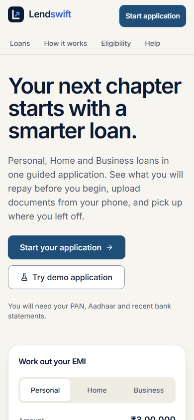 |
| 1 Loan | 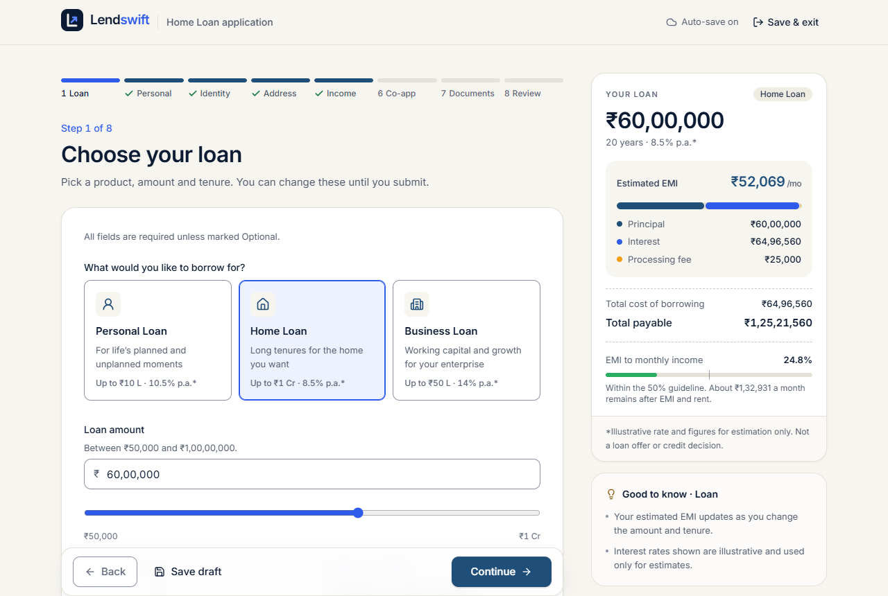 | 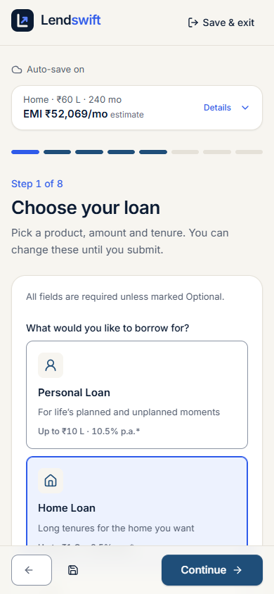 |
| 2 About you | 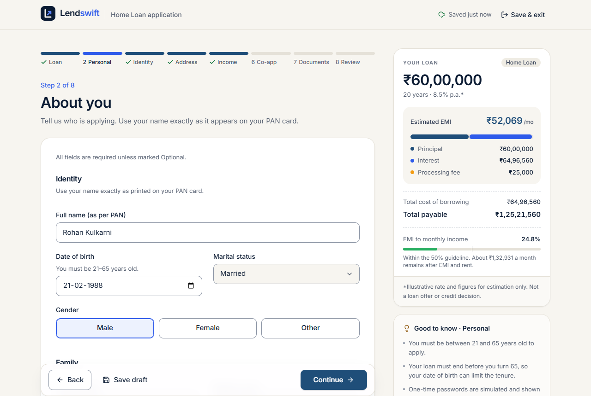 | 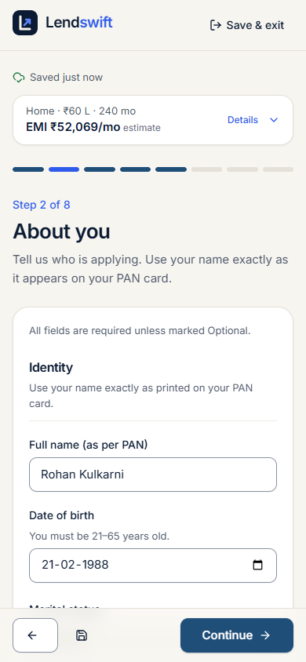 |
| 3 Identity | 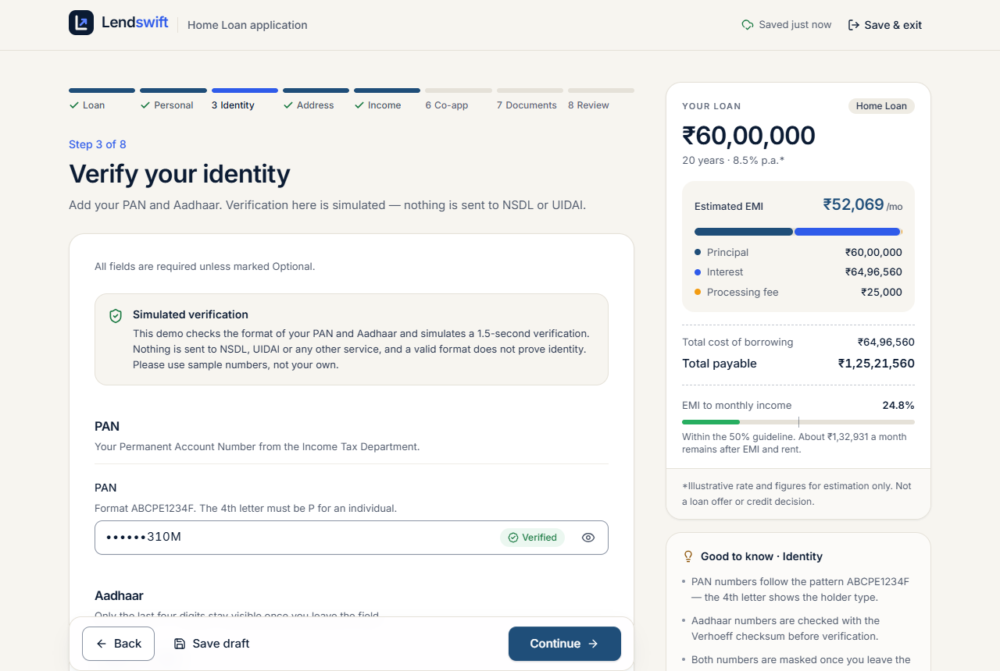 | 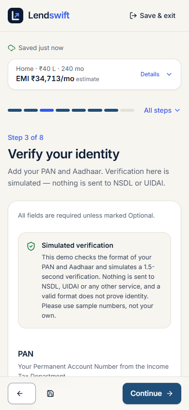 |
| 4 Address | 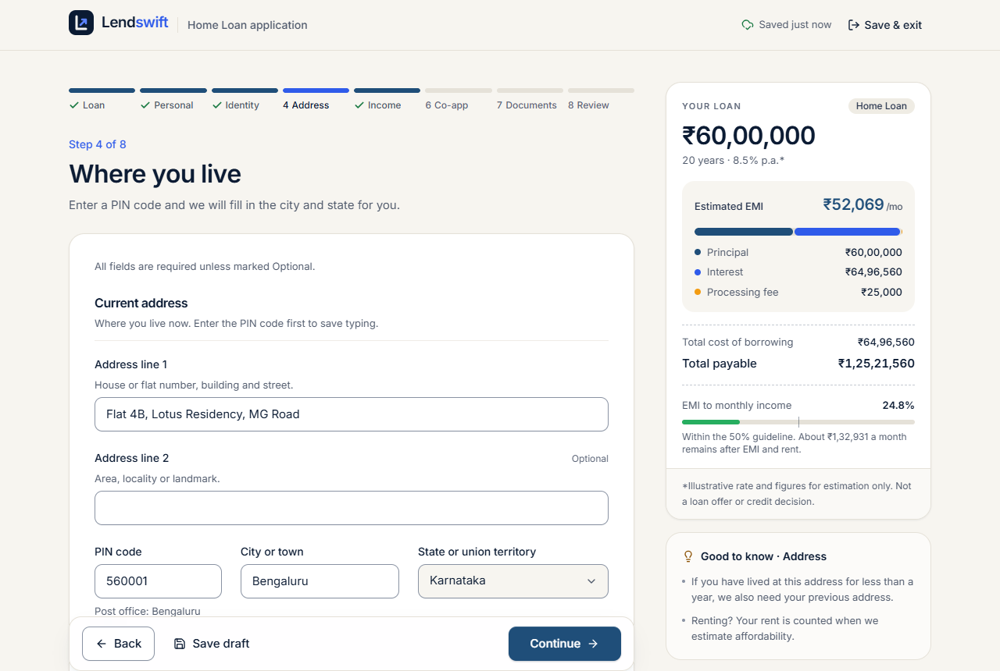 | 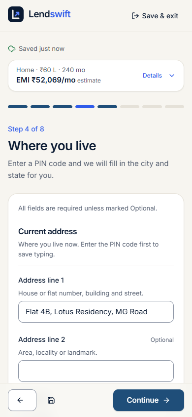 |
| 5 Income | 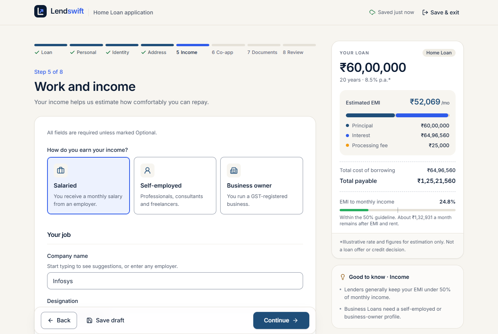 | 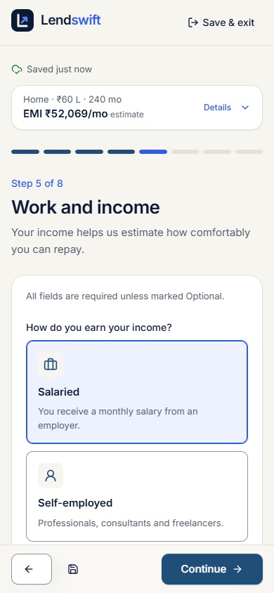 |
| 6 Co-applicant | 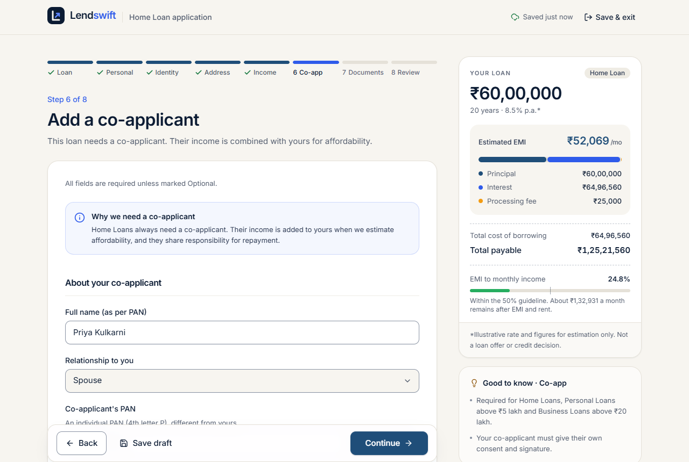 | 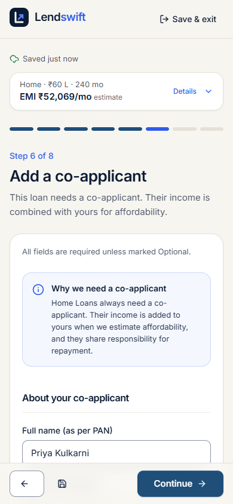 |
| 7 Documents | 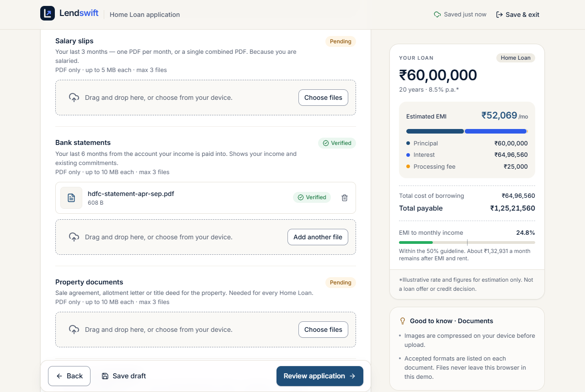 | 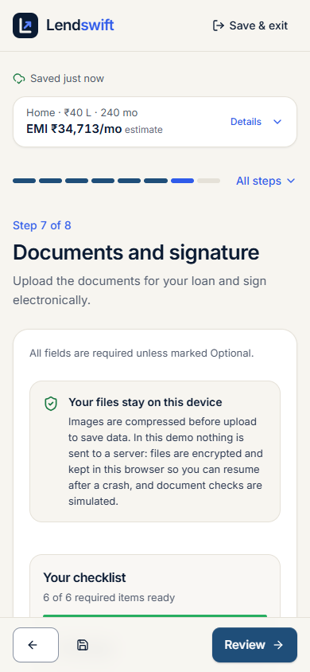 |
| 8 Review | 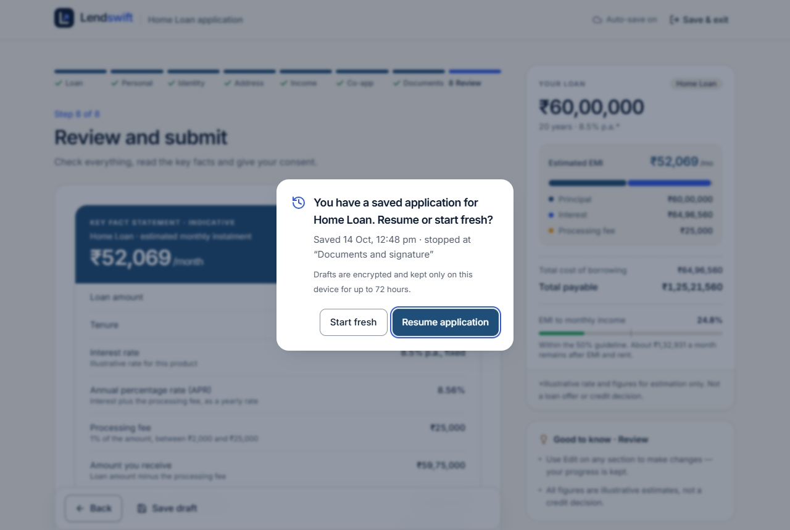 | 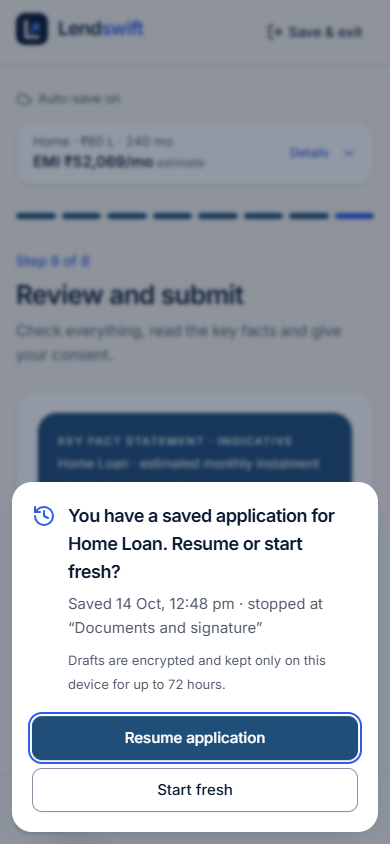 |
| Submitted | 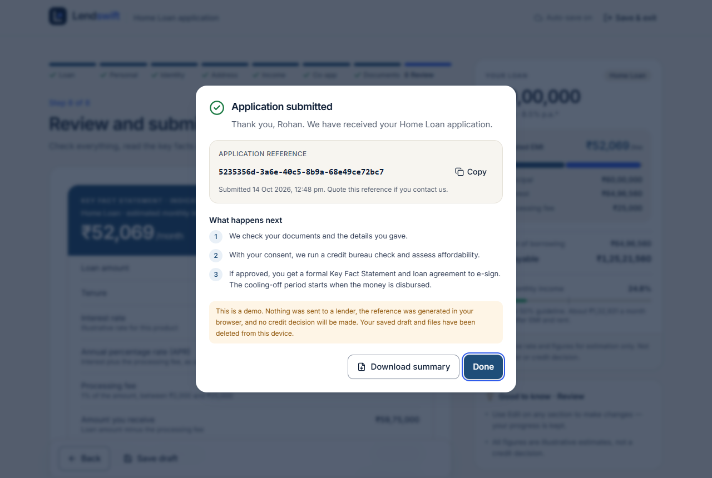 | 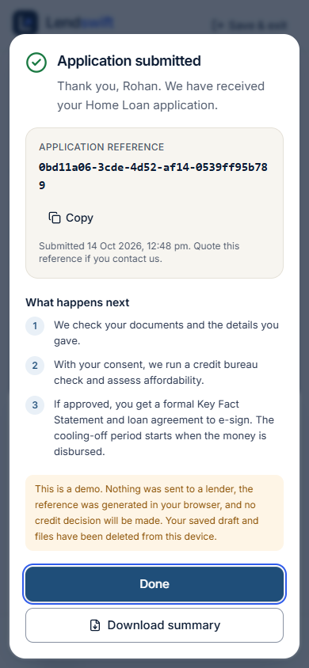 |

## Assumptions and known limitations

Assumptions (the smallest defensible choice where the brief was silent):

- The mandatory directory tree in section C1 is missing from the brief, so the layout follows
  the file names the brief mentions; see ARCHITECTURE.md.
- Business owners also give a monthly income, which the EMI-to-income ratio needs.
- "Max 3 files per document" applies everywhere, so salary slips, bank statements and GST
  returns accept combined PDFs. Aadhaar needs both sides: two images or one PDF.
- Proof of address on Step 4 is optional (Aadhaar usually carries the address).
- Errors stay hidden until a field is changed or Continue is pressed, never on first render.
- Interest rates are fixed per product and illustrative; the processing fee is 1%, between
  ₹2,000 and ₹25,000.

Limitations:

- **No back end.** Verification, PIN lookup, upload and submission are simulated; the reference
  number is a client-side UUID.
- **Key management.** The AES key is derived from a passphrase shipped in the bundle, as the
  brief allows. It defeats casual inspection and detects tampering, but not code running on
  the same origin.
- **Mobile OTP is required, email OTP optional;** codes are shown on screen.
- The PIN directory is a sample (100+ codes); unknown PINs can still be typed manually.
- Grievance and support emails use the reserved `.example` domain.
- **Browsers.** The full E2E suite runs in Electron 138 (Chromium) and the audits in Chrome 155.
  Firefox, Safari and old Chromium are covered only by the smoke journey on Chromium 90,
  Firefox 87 and WebKit 14.2. Edge (Chromium) was not run separately, and no real iOS or
  Android device was available.
- **Screen readers.** Checked automatically only; the manual NVDA and VoiceOver pass in
  `docs/screen-reader-checklist.md` has not been run yet.
- **`/apply` LCP** is 3.4 s on Lighthouse's simulated slow 4G, above the brief's 2.5 s target.
- **Timing budgets on a busy machine.** `performance-budgets` measures real time, so a heavily
  loaded machine can push a single sample over its budget. On 18 October, 1 run in 8 had a
  65 ms first auto-save write (budget 50 ms); the build without the motion changes was just
  as noisy, with a 188 ms transition in another run.

## Deploy

The production build is static (`dist/`).

- **Vercel:** import the repository; `vercel.json` sets the build, the single-page-app
  fallback and security headers.
- **Netlify:** build command `npm run build`, publish directory `dist`; `public/_redirects`
  provides the fallback.
